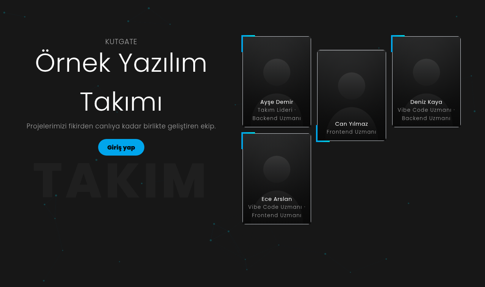
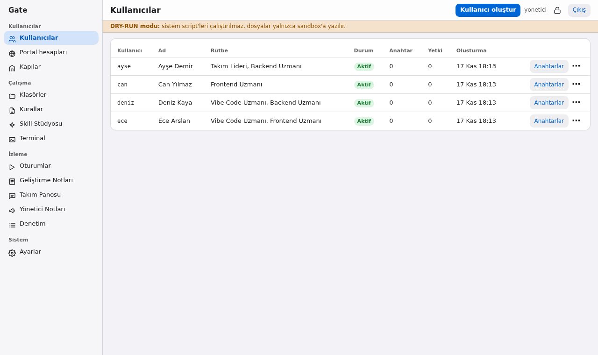

# KutGate

**Yazılım takımınızın sunucuda yapay zekâ (Claude Code) ile güvenle çalışmasını sağlayan yönetim ve çalışma paneli.**

KutGate'i bir sunucuya kurarsınız. Takım üyeleri tarayıcıdan girip yalnız kendilerine açtığınız proje klasörlerinde Claude Code ile çalışır. Kimin hangi klasöre erişeceğine, internete çıkıp çıkamayacağına ve dosya kopyalayıp kopyalayamayacağına tek bir yönetim panelinden siz karar verirsiniz.

> **Lisanslı yazılımdır.** Kaynak kodu inceleyebilirsiniz, ama kurup çalıştırmak için KUT40'tan lisans almanız gerekir. Lisans dosyası olmadan uygulama açılmaz. Ayrıntı: [Lisans nasıl alınır?](#lisans-nasıl-alınır) · [`LICENSE`](LICENSE)


*Portal açılış sayfası: takımınızın adı ve üyeleri. Üye kartına ya da "Giriş yap" düğmesine basan kişi kendi hesabıyla girer. (Görüntüdeki kişiler örnektir.)*

---

## İçindekiler

1. [Ne işe yarar?](#ne-işe-yarar)
2. [Kimler için?](#kimler-için)
3. [Özellikler](#özellikler)
4. [Nasıl çalışır?](#nasıl-çalışır)
5. [Gereksinimler](#gereksinimler)
6. [Kurulum (adım adım)](#kurulum-adım-adım)
7. [İlk kullanım](#ilk-kullanım)
8. [Ayarlar](#ayarlar)
9. [Güncelleme, lisans yenileme ve kaldırma](#güncelleme-lisans-yenileme-ve-kaldırma)
10. [Güvenlik modeli ve bilinen sınırlar](#güvenlik-modeli-ve-bilinen-sınırlar)
11. [Sık sorulan sorular](#sık-sorulan-sorular)
12. [Sorun giderme](#sorun-giderme)
13. [Lisans nasıl alınır?](#lisans-nasıl-alınır)
14. [İletişim](#iletişim)
15. [English summary](#english-summary)

---

## Ne işe yarar?

Kurum ya da şirket içinde birden çok kişi aynı sunucuda yazılım geliştiriyorsa şu sorular ortaya çıkar:

- Herkese sunucuda tam yetkili hesap açmadan, yalnız kendi projesinde çalışmasını nasıl sağlarım?
- Yapay zekâ asistanı (Claude Code) kodumuzu, sırlarımızı ya da başka projeleri sunucunun dışına taşımasın.
- Kim, ne zaman, hangi projede ne yaptı; bunu nasıl izlerim?

KutGate bu soruları tek panelde çözer. Her takım üyesi kendi Linux hesabıyla, **yalıtılmış bir alanda (sandbox)** çalışır. Bu alanda yalnız yetki verdiğiniz proje klasörleri görünür, ağ erişimi kısıtlıdır ve yönetici kuralları Claude Code'a zorunlu olarak yüklenir. Yönetici tüm bunları web panelinden, komut satırına girmeden yönetir.

## Kimler için?

- Ortak bir sunucuda **birden çok geliştiriciyle** çalışan kurumlar (belediyeler, kamu kurumları, şirketler, yazılım ekipleri).
- Geliştiricilerine **Claude Code** sunmak isteyen ama kaynak kodunun dışarı çıkmamasını isteyen yöneticiler.
- Stajyer, dış danışman ya da geçici çalışanlara **sınırlı ve süreli** erişim vermek isteyenler.

## Özellikler

### Yönetim paneli (yalnız yöneticiler)


*Yönetim paneli, Kullanıcılar ekranı. Soldaki menüden tüm modüllere ulaşılır. (Görüntü deneme modunda alındı; kişiler örnektir.)*

| Menü | Ne yapar? |
|---|---|
| **Kullanıcılar** | Linux kullanıcısı oluşturur, kilitler, siler; rütbe (Takım Lideri, Backend Uzmanı vb.) atar. Silinen kullanıcının ev dizini silinmez, arşive taşınır. |
| **Portal hesapları** | Kullanıcının tarayıcıdan giriş hesabını açar/kapatır, parolasını sıfırlar; kullanılabilecek en yüksek Claude düşünme düzeyini sınırlar. |
| **Kapılar** | Kullanıcı başına SFTP/dosya kopyalama, port yönlendirme ve internet erişimini (kapalı · izin listesi · açık) yönetir. |
| **Klasörler** | Proje klasörlerini (`/srv/projects/<ad>`) oluşturur; kullanıcılara okuma ya da okuma-yazma yetkisi verir. |
| **Kurallar** | Claude Code'un uyacağı genel ve kişiye özel kural dosyalarını düzenler. |
| **Skill Stüdyosu** | Claude Code için "skill" (hazır yetenek) yazar, sürüm geçmişini tutar; kişiye ya da herkese dağıtır. |
| **Terminal** | Yönetici için tarayıcıda sunucu terminali. |
| **Oturumlar** | Açık kullanıcı oturumlarını görür, gerekirse sonlandırır. |
| **Geliştirme Notları** | Kullanıcıların çalışmalarının 10 dakikada bir otomatik çıkarılan özetini gösterir. |
| **Takım Panosu / Yönetici Notları** | Takıma ve kişilere duyuru, görev, not bırakır; okundu bilgisini izler. |
| **Denetim** | Panelde yapılan her değişikliğin kim/ne zaman/ne kaydını tutar. |
| **Ayarlar** | Ekran kilidi süresi, Claude API anahtarı ve genel ayarlar. |

### Portal (takım üyeleri)

- **Takım sayfası:** Takımınızın adı ve üyeleri; giriş buradan yapılır.
- **Güvenli giriş:** Kullanıcı adı + parola, ardından kimlik doğrulayıcı uygulama (TOTP) ve ekran kilidi PIN'i. İlk girişte parola değiştirme zorunludur.
- **Claude Code sohbeti ve terminali:** Yapay zekâ asistanıyla sohbet; asistanın düşünme ve araç adımları, dosya farkları ve izin istekleri ekranda görünür. İsteyen klasik terminali kullanır.
- **Proje ağacı:** Yetkili olunan proje klasörlerine göz atma.
- **Önizleme (isteğe bağlı):** Geliştirilen uygulamayı `onizle-<kullanıcı>.<alan-adınız>` adresinde, yalnız sahibinin açabileceği şekilde canlı görme.
- **Git'e gönderme (isteğe bağlı):** Projeyi, yöneticinin izin verdiği GitHub hesabındaki depoya gönderme.
- **Pano ve notlar:** Takım panosunu okuma, panoya not bırakma, yönetici notlarını görme.

## Nasıl çalışır?

```
 Tarayıcı ──HTTPS──► (Cloudflare Tunnel / ters vekil) ──► Portal (:4180) ──► Yönetim sunucusu (127.0.0.1:4173)
                                                            │                    │
                                                            │                    └─ sudo ile YALNIZ izin listesindeki
                                                            │                       root betikleri (/usr/local/lib/gate)
                                                            └─ Kullanıcı oturumu: systemd-run + sandbox
                                                               (yalnız yetkili /srv/projects klasörleri, kısıtlı ağ)
```

- **İki servis vardır:** `gate-admin` (yönetim paneli ve API, yalnız sunucunun içinden erişilir) ve `gate-portal` (takımın girdiği kapı; yönetim paneline giden istekleri içeride aktarır).
- **Sistem değişiklikleri** (kullanıcı açma, yetki verme, güvenlik duvarı) yalnız `install.sh`'in root sahipliğinde kurduğu, tek tek izin verilmiş betiklerle yapılır. Panel sunucusu root olarak çalışmaz.
- **Veriler** sunucuda SQLite veritabanında tutulur (`/srv/gate/data-real/gate.db`). Dışarıya veri gönderilmez; KutGate "eve telefon etmez".
- **Lisans** her açılışta ve çalışırken saatte bir, sunucudaki imzalı lisans dosyasından **internete çıkmadan** doğrulanır.

## Gereksinimler

| Bileşen | Gerekli |
|---|---|
| İşletim sistemi | Ubuntu 24.04 LTS ya da daha yeni (systemd ≥ 250); Ubuntu 26.04 üzerinde çalışırken sınandı. |
| Donanım | 2 çekirdek, 4 GB RAM, 20 GB disk (en az). Her eşzamanlı Claude oturumu için yaklaşık +0,5 GB RAM önerilir. |
| Paketler | `acl`, `nftables`, `git`, `python3`, `sudo`, `openssh-server` |
| Node.js | **22 veya üstü**, servis kullanıcısına `nvm` ile kurulmuş olarak (ya da yolunu `GATE_NODE_BIN` ile verin) |
| Claude Code | Servis kullanıcısına kurulu `claude` komutu (`~/.local/bin/claude`) ya da yolu `GATE_CLAUDE_SRC` ile verilir |
| Anthropic | Takım üyelerinin kullanacağı Claude API anahtarı ya da Claude aboneliği (KutGate'e dahil değildir) |
| Alan adı | Portalın açılacağı bir ad (ör. `gate.kurumunuz.com`) ve HTTPS (Cloudflare Tunnel ya da kendi ters vekiliniz) |
| Lisans | KUT40'tan alınan `lisans.key` dosyası |

## Kurulum (adım adım)

Aşağıdaki komutlar root yetkili bir hesapla, temiz bir Ubuntu sunucuda çalıştırılır. Ayrıntılı teknik açıklama: [`docs/INSTALL.md`](docs/INSTALL.md).

**1. Lisansınızı alın.** [İletişim](#iletişim) bilgilerinden bize ulaşın. Size kurum adınıza imzalı bir `lisans.key` dosyası gönderilir. Bu dosyayı sunucuya kopyalayın (ör. `/root/lisans.key`).

**2. Paketleri ve servis kullanıcısını hazırlayın.**

```bash
sudo apt update
sudo apt install -y acl nftables git python3 openssh-server curl
sudo adduser --disabled-password --gecos "" gate      # servis kullanıcısı (adı size kalmış)
```

**3. Servis kullanıcısına Node.js 22 ve Claude Code kurun.**

```bash
sudo -iu gate
curl -fsSL https://raw.githubusercontent.com/nvm-sh/nvm/v0.40.3/install.sh | bash
source ~/.nvm/nvm.sh && nvm install 22
curl -fsSL https://claude.ai/install.sh | bash          # ~/.local/bin/claude
exit
```

**4. KutGate'i indirip `/srv/gate` altına açın ve derleyin.**

```bash
sudo git clone https://github.com/Kut40/KutGate2.git /srv/gate   # ya da size gönderilen paketi /srv/gate altına açın
sudo chown -R gate:gate /srv/gate
sudo -iu gate bash -c 'source ~/.nvm/nvm.sh && cd /srv/gate/backend && npm ci && cd ../frontend && npm ci && npm run build'
```

**5. Kurulum betiğini kendi bilgilerinizle çalıştırın.**

```bash
sudo GATE_REAL=1 \
     GATE_SERVICE_USER=gate \
     GATE_LICENSE_SRC=/root/lisans.key \
     GATE_PORTAL_HOSTNAME=gate.kurumunuz.com \
     GATE_TEAM_NAME="Yazılım Takımımız" \
     GATE_SSH_ALLOW_V4="10.0.0.0/8 192.168.1.0/24" \
     bash /srv/gate/scripts/install.sh
```

Başarılıysa ekrana `{"ok":true}` yazar. Betik hiçbir değeri tahmin etmez; eksik ya da hatalı bir değer verilirse **hiçbir şeyi değiştirmeden** durur ve nedenini yazar. Tüm değişkenler: [Ayarlar](#ayarlar).

**6. Servisleri başlatın.**

```bash
sudo systemctl start gate-admin gate-portal
systemctl status gate-admin gate-portal          # ikisi de "active (running)" olmalı
journalctl -u gate-portal -n 20                   # "KutGate lisansı: <kurumunuz> · bitiş ..." satırını görmelisiniz
```

**7. Portalı internete açın (HTTPS).** Cloudflare Tunnel ile `https://gate.kurumunuz.com` → `http://localhost:4180` yönlendirmesi yapın (adımlar [`docs/INSTALL.md`](docs/INSTALL.md#cloudflare-tüneli-cloudflared) içinde). Kendi ters vekilinizi (nginx, Caddy) de kullanabilirsiniz; tek şart, portalın HTTPS ile ve yukarıda verdiğiniz adla açılmasıdır.

**8. (Önerilir) SSH ve portal erişimini yalnız güvendiğiniz ağlara kısıtlayın.**

```bash
sudo bash /srv/gate/scripts/ssh-firewall.sh apply    # kuralı uygular; erişiminizi yeni bir SSH oturumuyla sınayın
sudo bash /srv/gate/scripts/ssh-firewall.sh keep     # sınama başarılıysa kalıcı yapar (yapmazsanız kendiliğinden geri alınır)
```

## İlk kullanım

1. **İlk yönetici hesabı** yalnız sunucunun içinden açılabilir (güvenlik gereği internetten açılamaz). Kendi bilgisayarınızdan SSH tüneli kurun ve tarayıcıda açın:
   ```bash
   ssh -L 4173:127.0.0.1:4173 <kullanıcı>@<sunucu>
   ```
   Tarayıcıda `http://127.0.0.1:4173/admin/` adresinde yönetici adı ve parola (en az 10 karakter) belirleyin, ardından 4 haneli ekran kilidi PIN'inizi tanımlayın. **Ayarlar**'dan kimlik doğrulayıcı uygulamayı (TOTP) da açmanızı öneririz.
2. **Klasörler** menüsünden bir proje klasörü açın (ör. `web-sitesi`).
3. **Kullanıcılar** menüsünden takım üyesini ekleyin; **Klasörler**'den ona yetki verin.
4. **Portal hesapları**'ndan üyenin portal hesabını açın; size verilen geçici parolayı üyeye güvenli bir yoldan iletin.
5. **Kapılar** menüsünde üyenin Claude'a ulaşabilmesi için "Ajan için Anthropic API izni"ni açın.
6. **Ayarlar**'dan Claude API anahtarını girin (ya da üye kendi anahtarını/aboneliğini kullanır).
7. Üye `https://gate.kurumunuz.com` adresine girer, ilk girişte parolasını değiştirir, kimlik doğrulayıcısını ve PIN'ini kurar ve çalışmaya başlar.

Yönetici parolanızı unutursanız: `sudo /srv/gate/scripts/admin-reset.sh <yönetici_adı>`

## Ayarlar

Kuruma özel **hiçbir bilgi kodda yer almaz**; hepsi kurulumda verilir ve `/etc/gate/gate.env` dosyasına yazılır. Sonradan değiştirmek için bu dosyayı düzenleyip `sudo systemctl restart gate-admin gate-portal` çalıştırın.

| Değişken | Zorunlu | Açıklama |
|---|---|---|
| `GATE_SERVICE_USER` | evet | Servislerin çalıştığı sistem kullanıcısı. |
| `GATE_LICENSE_SRC` | ilk kurulumda | Lisans dosyanızın yolu; `/etc/gate/license.key` olarak kopyalanır. |
| `GATE_PORTAL_HOSTNAME` | evet | Portalın dışarıdan açılacağı ad (ör. `gate.kurumunuz.com`). |
| `GATE_TEAM_NAME` | hayır | Takım sayfasında görünen ad (varsayılan: `Takım`). |
| `GATE_PREVIEW_DOMAIN` | hayır | Önizleme alt alan adlarının kökü (ör. `kurumunuz.com`). Verilmezse önizleme **kapalı** kalır. Joker (`*.kurumunuz.com`) DNS ve HTTPS gerektirir. |
| `GATE_GITHUB_ORG` | hayır | Git'e gönderimde izin verilen GitHub hesabı/kuruluşu. Verilmezse git gönderimi **kapalı** kalır. |
| `GATE_SSH_ALLOW_V4` | hayır | SSH ve portala izinli ağlar (boşlukla ayrılmış CIDR listesi). IPv6 için `/etc/gate/ssh-allow-v6` dosyasına satır satır yazın. |
| `GATE_SHARED_APPS` | hayır | Portal arkasından yayınlanacak ek uygulamalar (JSON, `gate.env` içine elle eklenir). |
| `GATE_NODE_BIN` | hayır | Node.js yolu (varsayılan: servis kullanıcısının `nvm` içindeki en yeni sürüm). |
| `GATE_CLAUDE_SRC` | hayır | `claude` dosyasının yolu (varsayılan: servis kullanıcısının `~/.local/bin/claude`). |

Portlar: yönetim `127.0.0.1:4173` (dışa kapalı), portal `4180`.

## Güncelleme, lisans yenileme ve kaldırma

**Yeni sürüme geçmek**

```bash
sudo systemctl stop gate-admin gate-portal
sudo cp -a /srv/gate/data-real /root/gate-yedek-$(date +%F)                # önce veriyi yedekleyin
cd /srv/gate && sudo -u gate git pull                                      # ya da yeni paketi açın
sudo -iu gate bash -c 'source ~/.nvm/nvm.sh && cd /srv/gate/backend && npm ci && cd ../frontend && npm ci && npm run build'
sudo GATE_REAL=1 bash /srv/gate/scripts/install.sh                         # önceki ayarlarınız korunur
sudo systemctl start gate-admin gate-portal
```

Güncellemede `install.sh` daha önce verdiğiniz ayarları (`/etc/gate/gate.env`) korur; yalnız değiştirmek istediğiniz değişkeni yeniden verin.

**Lisansı yenilemek:** Size gönderilen yeni `lisans.key` dosyasını yerine koyup servisleri yeniden başlatın:

```bash
sudo install -o root -g gate -m 640 yeni-lisans.key /etc/gate/license.key
sudo systemctl restart gate-admin gate-portal
```

Lisansın süresi dolduğunda servisler (en geç bir saat içinde) durur. Verileriniz silinmez; yeni lisansla aynen kaldığınız yerden devam edersiniz.

**Kaldırmak**

```bash
sudo systemctl disable --now gate-admin gate-portal gate-egress gate-lo-guard
sudo rm -f /etc/systemd/system/gate-{admin,portal,egress,lo-guard}.service /etc/sudoers.d/gate
sudo nft delete table inet gate 2>/dev/null; sudo nft delete table inet gate_lo 2>/dev/null
sudo rm -f /etc/ssh/sshd_config.d/gate-00-portal.conf && sudo systemctl reload ssh
sudo nft delete table inet gate_ssh 2>/dev/null; sudo systemctl disable --now gate-ssh-firewall 2>/dev/null
sudo systemctl daemon-reload
# Veriler ve kullanıcı hesapları bilerek silinmez: /srv/gate, /srv/projects, /etc/gate, /var/lib/gate-board
```

## Güvenlik modeli ve bilinen sınırlar

**Neler korunur**

- Takım üyesi yalnız yetki verilen proje klasörlerini görür; sunucunun geri kalanı, diğer kullanıcılar ve sistem dosyaları sandbox dışında kalır.
- Varsayılan olarak internet erişimi **kapalıdır**; yalnız yöneticinin açtığı adreslere (ör. Anthropic API) çıkılabilir.
- Claude Code'a "dosya içeriğini dışarı aktarma, toplu gösterme" kuralları yönetici tarafından zorunlu olarak yüklenir; kullanıcı bunları değiştiremez.
- Yönetim paneli internete açılmaz; ilk yönetici yalnız sunucunun içinden oluşturulabilir. Girişlerde TOTP, ekran kilidi, hız sınırı ve CSRF koruması vardır.
- Her yönetici işlemi denetim kaydına yazılır.

**Bilinen sınırlar (dürüstçe)**

- Ekran görüntüsü almak ya da ekrandaki kodu elle yazmak teknik olarak engellenemez; gizlilik sözleşmesi (NDA) gerekir.
- Kopyalama engeli tarayıcı tarafındadır; kararlı ve yetkili bir kullanıcı bazı yolları deneyebilir. Ayrıntı: [`docs/INSTALL.md` → Bilinen sınırlar](docs/INSTALL.md#bilinen-sınırlar).
- Portal kullanıcısı, kendisine verilen Claude API anahtarını oturum içinde görebilir.

Bir güvenlik açığı bulursanız lütfen herkese açık "issue" açmayın; [İletişim](#iletişim) bölümündeki e-posta adresine yazın.

## Sık sorulan sorular

**Satın almadan deneyebilir miyim?** Değerlendirme için süreli bir deneme lisansı talep edebilirsiniz; [bize yazın](#iletişim).

**Kaynak kod açık, lisanssız kullanabilir miyim?** Hayır. Kodu incelemek serbesttir; kurmak, çalıştırmak, değiştirip dağıtmak için yazılı lisans gerekir ([`LICENSE`](LICENSE)).

**Lisans internet bağlantısı ister mi?** Hayır. Lisans dosyası sunucuda, internete çıkmadan doğrulanır. KutGate dışarıya hiçbir kullanım verisi göndermez.

**Claude aboneliği/API anahtarı lisansa dahil mi?** Hayır. Claude kullanımı Anthropic ile sizin aranızdadır; KutGate yalnız bu kullanımı güvenli ve yönetilebilir kılar.

**Kaç kullanıcı ekleyebilirim?** Lisans koşullarınıza bağlıdır; teknik bir sınır yoktur, sınır sunucunuzun kaynaklarıdır.

**Docker ile çalışıyor mu?** Hayır. KutGate kullanıcı, sandbox ve güvenlik duvarı yönettiği için doğrudan sunucuya (systemd servisi olarak) kurulur.

**Verilerim nerede?** Tamamen kendi sunucunuzda: veritabanı `/srv/gate/data-real`, projeler `/srv/projects`, ayarlar `/etc/gate`.

**Arayüz hangi dilde?** Türkçe.

**Lisansın süresi dolarsa ne olur?** Servisler durur, veriler silinmez. Yeni lisans dosyasını koyup servisleri başlattığınızda kaldığınız yerden devam edersiniz.

## Sorun giderme

| Belirti | Neden / Çözüm |
|---|---|
| `install.sh` "GATE_... verilmedi/geçersiz" deyip duruyor | İlgili değişkeni doğru biçimde verin; betik eksik bilgiyle hiçbir şeyi değiştirmez. |
| Servis `failed` durumunda (çıkış kodu 78), kayıtta `HATA: lisans ...` | `/etc/gate/license.key` yok, bozuk ya da süresi dolmuş. Lisans hatasında servis bilerek yeniden denemez; yeni lisansı yerine koyup `sudo systemctl restart gate-admin gate-portal` çalıştırın. |
| `install.sh` "node bulunamadı" diyor | Servis kullanıcısına `nvm install 22` yapın ya da `GATE_NODE_BIN=/tam/yol/node` verin. |
| `install.sh` "claude ikili dosyası bulunamadı" diyor | Servis kullanıcısına Claude Code kurun ya da `GATE_CLAUDE_SRC` verin. |
| Portal açılıyor ama Claude cevap vermiyor | Kapılar menüsünde "Ajan için Anthropic API izni" açık mı ve API anahtarı girildi mi kontrol edin. |
| Önizleme düğmesi çalışmıyor | `GATE_PREVIEW_DOMAIN` verilmemişse önizleme bilerek kapalıdır; joker DNS ve HTTPS ile birlikte ayarlayın. |
| Git'e gönderme "depoya bağlı değil" diyor | `GATE_GITHUB_ORG` verilmemiş ya da depo o hesaba ait değil. |
| SSH bağlantınız kesildi | `ssh-firewall.sh apply` sonrası `keep` demezseniz kural 2 dakika içinde kendiliğinden geri alınır. İzin listenize kendi ağınızı ekleyin. |

Kayıtlar: `journalctl -u gate-admin -u gate-portal -f`

## Lisans nasıl alınır?

1. [İletişim](#iletişim) bilgilerinden bize ulaşın; kurum adınızı, yaklaşık kullanıcı sayınızı ve istediğiniz süreyi bildirin.
2. Size kurumunuz adına **dijital olarak imzalanmış** bir `lisans.key` dosyası gönderilir. Dosyada kurum adınız, lisans numaranız ve bitiş tarihiniz yazar.
3. Dosyayı kurulumda `GATE_LICENSE_SRC` ile verin. Servis açılırken `KutGate lisansı: <kurumunuz> · no <lisans no> · bitiş <tarih>` satırını kayda yazar.

Lisans dosyası kişiye/kuruma özeldir; başka kurumlarla paylaşılamaz. Koşullar: [`LICENSE`](LICENSE).

## İletişim

**KUT40** — lisans, deneme, kurulum desteği ve her türlü soru için:

| | |
|---|---|
| **Yetkili** | Erkan Yıldız |
| **Telefon** | [+90 532 409 60 43](tel:+905324096043) |
| **WhatsApp** | [+90 532 409 60 43](https://wa.me/905324096043) — WhatsApp'tan da ulaşabilirsiniz |
| **E-posta** | [bilgi@kut40.com](mailto:bilgi@kut40.com) |

---

## English summary

**KutGate** is a web-based admin and workspace panel that lets a software team work safely with **Claude Code** on a shared Linux server. Admins create users, grant per-project folder access, control network egress and file transfer, manage Claude rules and skills, and audit every change. Team members log in through a browser (password + TOTP + PIN) and work in a sandbox that only exposes the project folders they were granted.

KutGate is **proprietary, licensed software**: you may read the source, but installing and running it requires a signed license file from KUT40 (the service will not start without one; the license is verified offline, nothing is sent home). The UI is in Turkish. For licensing, trials and support contact **Erkan Yıldız** — +90 532 409 60 43 (phone/WhatsApp) — [bilgi@kut40.com](mailto:bilgi@kut40.com).
